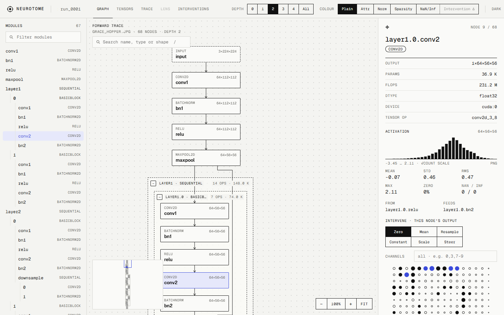
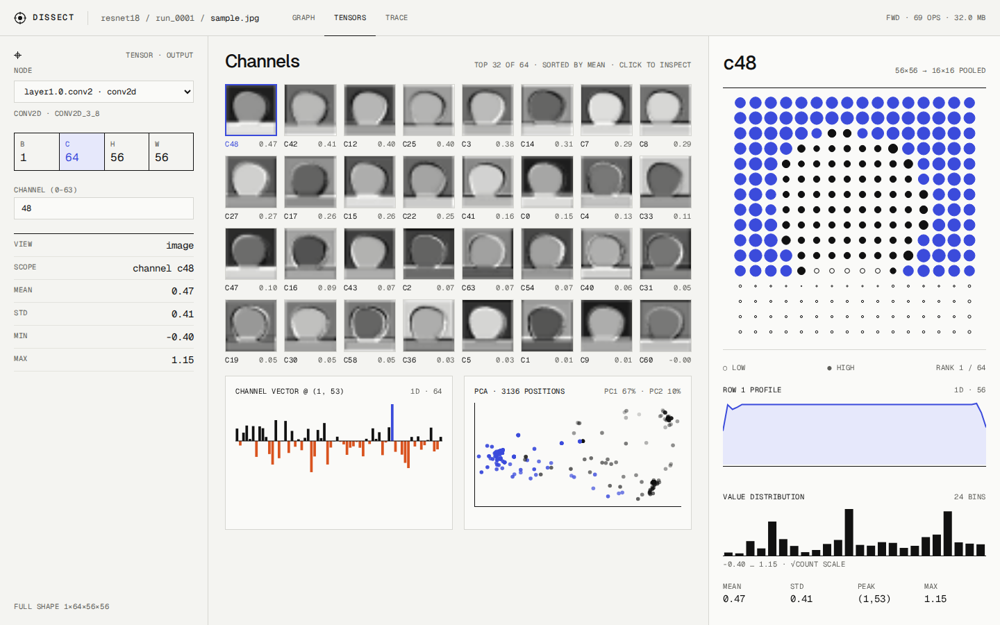
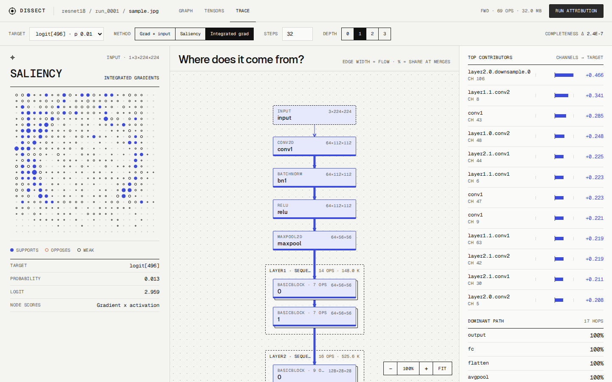

# Neurotome

**Open the model. See every signal.** A local web workbench for dissecting one PyTorch model on one
input. It captures every op of a forward pass, lets you browse the computation graph, and opens any
tensor as maps, signals or projections. It also traces which parts of the model and the input drove an output.



| Tensors | Trace |
|---|---|
|  |  |

> Status: **MVP**, in release preparation. The full pipeline works end to end. See the
> [Getting started](docs/index.md) page, [docs/PLAN.md](docs/PLAN.md) for the MVP scope and roadmap, and
> [docs/RELEASE.md](docs/RELEASE.md) for how a version reaches PyPI.

## Quick start

Requirements: Python 3.10+, Node 20+, [uv](https://docs.astral.sh/uv/). `make` is optional.

**Windows (PowerShell)**

```powershell
uv venv .venv
uv pip install --python .venv\Scripts\python.exe -e "./backend[dev]"
cd frontend; npm ci; cd ..
.\scripts\dev.ps1                   # API :7070 (reload) + UI :5173; Ctrl+C stops both
```

**Linux / macOS**

```bash
uv venv .venv
uv pip install --python .venv/bin/python -e "./backend[dev]"
(cd frontend && npm ci)
./scripts/dev.sh                    # API :7070 (reload) + UI :5173; Ctrl+C stops both
```

Open http://localhost:5173 and press **Capture forward pass** (try the model `py:examples.custom_model:build`).

**GPU / CPU-only PyTorch.** The install above takes the default PyTorch build for your platform. For a specific
CUDA version or a small CPU-only build, install torch first (e.g.
`uv pip install --python <venv python> torch torchvision --index-url https://download.pytorch.org/whl/cpu`).

**With `make`** (Git Bash, MSYS2, Linux, macOS; works with `.venv/Scripts` or `.venv/bin`):

```bash
make install        # Python venv + editable backend + npm packages
make dev            # API on :7070 and UI on :5173 (hot reload)
```

### From Python or a notebook

```python
import neurotome
neurotome.open(model, x)               # captures, then serves the UI at http://127.0.0.1:7070
neurotome.open(model, x, block=False)  # notebooks: server runs in the background
```

### From the command line

```bash
neurotome capture torchvision:resnet18 --weights DEFAULT --image cat.jpg
neurotome capture py:examples.custom_model:build   # your own model (see examples/custom_model.py)
neurotome capture torchvision:resnet50 --modules layer3,layer4 --max-capture-mb 512   # selective, budgeted
neurotome serve                                    # serves the built UI + API on :7070
```

### Single-process build and the wheel

```bash
cd frontend && npm run build && cd ..    # builds the UI into backend/neurotome/static
neurotome serve                          # UI and API together on http://127.0.0.1:7070
uv build backend                         # backend/dist/neurotome-<v>.tar.gz and -py3-none-any.whl (UI included)
python scripts/check_wheel.py "backend/dist/*.whl" --sdist "backend/dist/*.tar.gz" [--install]
```

`--install` also installs the wheel into a fresh temp venv (CPU torch) and checks that it serves the UI.

## Capture

- **Background job**: the Home form starts a capture job (Load model → Build input → Trace → Save tensors i/N →
  Summarise) with a progress bar and `Cancel`, then opens the graph. `neurotome capture` and `neurotome.open()`
  stay synchronous.
- **Budget**: tensors are saved until the next one would exceed the budget (`NEUROTOME_MAX_CAPTURE_MB`, default
  2048, or `Budget · MB` per run); later ops keep their stats but no tensor. A `Truncated` banner says so and those
  nodes are drawn dotted with `∅`.
- **Selective**: `Modules` (e.g. `layer3, layer4`) saves tensors only inside those modules; the whole graph is still
  recorded (`Selective` banner).
- **Errors** are specific and never a traceback: trace failures, outputs with no tensor, integer inputs (input
  attribution is skipped with a note), missing tensors, models that can no longer be loaded, CUDA out of memory.
- **Theme**: light or dark, following the system until you pick one with the toggle in the top bar.

## Graph workspace

- **Fold per module**: `+` on a module node expands it, `−` on a group box collapses it; the depth
  buttons reset these overrides. The fold lives in the URL (`#/runs/<id>/graph?depth=1&expand=layer1.0:1&collapse=…`),
  so a link reopens the same view.
- **Search** (`/` or Ctrl/Cmd+K): name, op type or shape (`64x56x56`). Picking a hit that is folded
  inside a collapsed module opens its ancestors, selects it and centres it.
- **Keyboard** (click or Tab into the canvas): ↓ child, ↑ parent, ←/→ siblings, `Enter` opens the
  tensor, `Escape` clears the search, `+`/`-` expand/collapse the selection.
- **Colour**: Plain · Attr (grad × act) · Norm (RMS) · Sparsity (zero %) · NaN/Inf flag · Patch Δ, with a legend.
- **Patch** (inspector): replace the node's output with zeros, its spatial mean, or the same node of another run
  of this model, and re-run the forward pass. The panel shows Δlogit / Δprob of the top class; `Patch Δ` colours
  every node by ‖after − before‖ / ‖before‖. `Trace ch →` and `Layer attribution` jump to the Trace view.
- **Hover** an edge for the shape it carries and any dtype/device change; the minimap (bottom left)
  pans on click or drag.

## Tensor inspector

- **Pick a pixel**: click the dot matrix (or the selected channel's tile) to move the inspected position; the channel
  vector and row profile follow, and a crosshair marks it. `py`/`px` live in the URL; `Peak` jumps back to the argmax.
- **Scale and colour**: per-channel or global scale (one range for every channel, so they are comparable);
  sequential or diverging (negative ↔ 0 ↔ positive) colours. Both are URL state (`norm=global`, `cmap=div`).
- **Over input**: draw the channel map, or in Trace the input attribution, over a ≤224 px preview of the input
  with an opacity slider. Runs captured before this feature have no preview; re-capture to add one.
- **Values**: NumPy-style slices (`[0, 12, 20:30, :]`, `[..., 0]`, `::-2`) show raw numbers in a paged table
  (at most 4096 values); `.npy ↓` downloads the whole slice (up to 2²⁴ values).
- **Compare**: two nodes side by side (default: the node's parent, e.g. pre vs post ReLU) on a shared scale
  when shapes match, plus Δ statistics, a Δ histogram, cosine similarity and max |Δ|.
- **Export**: every chart has a `PNG` button.
- **Trace from c<n>**: attribute the selected channel (Σ over positions) instead of a logit.

## Trace

- **Objective**: a logit (default: the top prediction) or an internal unit, i.e. one channel of a module output
  summed over positions (`obj=<op>&ch=<c>` in the URL; `← Logits` goes back). Input map, node scores, merge shares
  and the dominant path are all computed for that objective.
- **Merge shares**: at `add` / `cat` / other merges an edge's share is that parent's grad × input *through the
  merge*, so the dominant path follows real flow.
- **Layer attribution**: Layer IG or Layer conductance per channel of the selected node; pick a channel for its
  neuron conductance map over the input.
- **Method agreement**: `Compare methods` scores every pair of input methods (and per-channel methods for the
  selected node) by top-k Jaccard / overlap and Spearman rank correlation.
- Long work (IG, layer methods, agreement, patching) runs as a background job with a progress bar and `Cancel`;
  results are cached in the run folder, so a repeat is instant.

## Layout

```
backend/            Python package `neurotome` (FastAPI, TorchLens, Captum)
  neurotome/        capture.py · graph.py · tensors.py · slicing.py · attribution.py · jobs.py · runs.py · errors.py · api.py · cli.py
  tests/            end-to-end tests (tiny model + ResNet-18)
frontend/           Vite + React + TypeScript UI
  e2e/              Playwright specs (home · graph · tensors · trace) and the server global setup
  src/views/        Home · Graph · Tensors · Trace
  src/components/   GraphCanvas (ELK worker, canvas edges), Minimap, GraphSearch, charts, panels,
                    InputOverlay, ValuesTable, ComparePanel, PatchPanel, JobProgress, AgreementMatrix
  src/lib/          pure logic: layout, viewport, graphState, tensorState, traceState, jobs, exportPng (tested with vitest)
design/             tokens.json + the canvas mockups that set the visual direction
docs/               index.md (Getting started) · PLAN.md · ARCHITECTURE.md · DESIGN.md · RELEASE.md · specs/ (mkdocs.yml)
examples/           quickstart.py · custom_model.py
scripts/            dev.sh · dev.ps1 · bench.py · check_wheel.py
```

## Commands

Run from the repository root with the venv's Python (`.venv\Scripts\python.exe` on Windows, `.venv/bin/python`
elsewhere); the Makefile target is in brackets.

| | |
|---|---|
| `cd backend && python -m pytest -q` | backend tests [`make test-backend`; `make test` adds the frontend] |
| `cd backend && python -m ruff check .` | lint [`make lint`] |
| `cd frontend && npm run typecheck && npm test` | frontend typecheck and vitest [`make test-frontend`] |
| `cd frontend && npm run e2e` | builds the UI, starts `neurotome serve` (CPU, temp runs dir, free port) and runs the Playwright suite over the four views [`make e2e`]; first time: `npx playwright install chromium` |
| `uv build backend` | sdist and wheel with the UI [`make wheel`, which also builds the UI and checks the wheel] |
| `python scripts/bench.py` | benchmarks for the success criteria (ResNet-50 capture, tensor view p95, IG-32 on CPU) [`make bench`] |
| `mkdocs serve` | docs site on http://127.0.0.1:8000 (`pip install -e "./backend[docs]"`); `mkdocs build --strict` [`make docs`] |
| `make clean` | remove builds, caches and local runs |

Releasing: [docs/RELEASE.md](docs/RELEASE.md).

## Configuration

| Env var | Default | |
|---|---|---|
| `NEUROTOME_RUNS_DIR` | `./runs` | where runs are stored |
| `NEUROTOME_HOST` / `NEUROTOME_PORT` | `127.0.0.1` / `7070` | keep localhost: `py:` model specs import and run code |
| `NEUROTOME_DEVICE` | `cpu` | e.g. `cuda`, `cuda:1`, `mps` |
| `NEUROTOME_MAX_CAPTURE_MB` | `2048` | activation budget per run; later ops are recorded without tensors |
| `NEUROTOME_MAX_LIVE_MODELS` | `2` | models (+ inputs) kept loaded for attribution; least recently used is evicted |

## Built on

[TorchLens](https://github.com/johnmarktaylor91/torchlens) (capture) · [Captum](https://github.com/meta-pytorch/captum)
(attribution) · [ELK](https://eclipse.dev/elk/) via elkjs (layout) · FastAPI · React · Geist fonts.

## License

[Apache License 2.0](LICENSE). Copyright 2026 Mahdi-Si.
