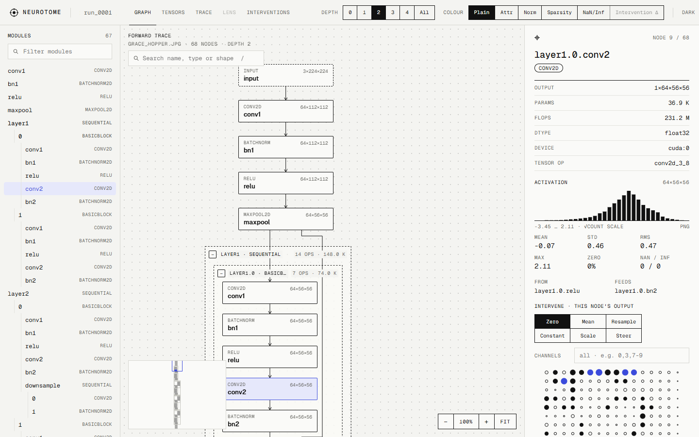

# Getting started

**Open the model. See every signal.** Neurotome is a local web workbench for dissecting one PyTorch model on one
input. It captures every op of a forward pass, lets you browse the computation graph, opens any tensor as maps,
signals or projections, and traces which parts of the model and of the input drove an output. Everything runs on
your machine: runs live in a folder on your disk and the server binds to localhost.



## Install

Requirements: Python 3.10+ and PyTorch 2.2+. Install the PyTorch build you want first (CPU-only or a CUDA version,
see pytorch.org), then Neurotome.

**From source (today).** Needs [uv](https://docs.astral.sh/uv/) and Node 20+:

```bash
git clone <this repository> neurotome && cd neurotome
uv venv .venv
uv pip install --python .venv/bin/python -e "./backend[dev]"      # Windows: .venv\Scripts\python.exe
cd frontend && npm ci && npm run build && cd ..                   # builds the UI into the package
```

**From PyPI (once published).** The wheel carries the built UI:

```bash
pip install neurotome
```

**Extras.** `hf` adds Hugging Face models (`transformers`, `accelerate`) and `nnsight` the NNsight capture backend
for large models; both are optional and imported only when used:

```bash
pip install "neurotome[hf,nnsight]"        # from source: uv pip install ... -e "./backend[dev,hf,nnsight]"
```

## First run

```bash
neurotome serve                  # UI and API on http://127.0.0.1:7070
```

Open the page and fill the **New run** form on Home:

- **Model**: `torchvision:resnet18` (any torchvision classifier by name), a Hugging Face model as `hf:<repo_id>`
  (`hf:gpt2`, `hf:Qwen/Qwen2.5-0.5B`, `hf:google/vit-base-patch16-224`, or a local directory; needs the `hf` extra),
  or your own model as `py:<module>:<factory>`. From a source checkout, `py:examples.custom_model:build` is a small
  residual CNN on a 1×1×28×28 input that captures in about a second on a CPU, and `py:examples.tiny_lm:build` a tiny
  GPT-2 with a character tokenizer (offline), and `py:examples.signal_model:build` a small time-series model with a
  synthetic dataset (see [Time series with a dataset](#time-series-with-a-dataset)).
- **Weights**: random init (no download) or `DEFAULT` pretrained weights.
- **Sample**: `Text` (models with a tokenizer; the default for text models) or `File`: an image, a `.npy` (integer
  arrays stay token ids) or a `.pt` file; an empty file means a random tensor of the model's input shape, or random
  token ids for a text model. `Dataset` appears for a `py:` model whose module lists samples: filter, pick one.
- **Capture**: `Auto` (TorchLens, or NNsight for models above 1 B parameters when it is installed),
  `TorchLens · every op`, or `NNsight · module outputs` (smaller, module-level graph; interventions edit module
  outputs only).
- **Modules** (optional): capture tensors only inside these module addresses, e.g. `layer3, layer4`.
- **Budget · MB** (optional): the activation budget for this run; empty uses the server default.

`Capture forward pass` runs the capture as a background job with a progress bar and `Cancel`, then opens the graph.
From there the **Graph**, **Tensors**, **Trace**, **Lens** and **Interventions** tabs share the selected node; every
view state lives in the URL, so a link reopens the same view.

**Text models.** Tensors label rows with their tokens, every softmax opens as **attention** maps per head, the
**Trace** tab scores each input token (Layer IG on the embeddings from a pad-token baseline) and, for a causal LM,
the **Lens** tab shows the logit lens: what every layer would predict at each position.

**Interventions.** Edit what an op outputs and re-run the model: in the **Interventions** tab (or the graph
inspector's `Intervene` section) add edits to a set: zero, mean (over positions, or over the saved runs of this
model), resample from another run, constant, scale ×α, or steer (+α × a direction), each scoped by channels and by
pixels or tokens. `Run interventions` applies the whole set in one forward pass and saves the result with the run:
the change in the target logit and probability, the top-k before and after, and a before/after diff of every
downstream node (the graph's `Intervention Δ` colour, `Clean vs intervened` in the Tensors tab). For a causal LM,
`Generate` puts the clean and intervened continuations side by side.

## Time series with a dataset

A `py:` model module can bring its dataset, so any sample is analysed by its ref, with the raw signal shown next
to the transformed model input (`examples/signal_model.py` is a small, synthetic worked example):

```python
OUTPUT_KIND = "values"          # a score per step, not logits: the output summary is top-5 by value, no softmax

def build() -> nn.Module: ...   # forward(x: (1, T, C)) -> tensor, or a dict / tuple whose first tensor is the output

def list_samples() -> list[dict]:        # cheap: the model is not built; may be thousands long (the UI filters)
    return [{"ref": "rec01:0", "label": "segment 0 · 0–600 s", "group": "rec01"}, ...]

def load_sample(ref: str) -> dict:       # one sample as your own data pipeline makes it (batch of 1)
    return {"input": x,                  # required: a tensor or a tuple of tensors
            "name": "rec01 · segment 0", "steps": ["Frame: 16 s windows every 8 s", ...], "info": {"recording": "rec01"},
            "raw": {"fs": 4.0, "t0": 0.0, "time_label": "s from recording start",
                    "channels": [{"name": "hr", "unit": "bpm", "values": hr}, ...]},
            "blocks": [{"name": "hr · band power", "start": 0, "stop": 5, "labels": ["0.06–0.12 Hz", ...], "unit": "z"}],
            "time": {"axis": 1, "step_s": 8.0, "t0": 8.0}}   # step i at t0 + i · step_s, on the raw clock
```

Pick `Dataset` in the Home form (it appears when the module lists samples; filter by ref, label or group), or run
`neurotome capture py:examples.signal_model:build --sample rec01:0`. The Tensors tab's input node then shows the
sample's info rows, one envelope plot per raw channel and one heatmap per block of the model input, all on the raw
signal's clock, and the preprocessing steps. A module in another repository needs only to be importable: start the
server with that repository on `PYTHONPATH` (`PYTHONPATH=/path/to/repo neurotome serve`, PowerShell
`$env:PYTHONPATH = "C:\path\to\repo"`); only the model module is imported, never code from the runs folder.

## From the command line

```bash
neurotome capture torchvision:resnet18 --weights DEFAULT --image cat.jpg
neurotome capture hf:gpt2 --weights DEFAULT --text "The cat sat on the"
neurotome capture py:examples.custom_model:build --modules blocks.0 --max-capture-mb 64
neurotome serve --port 7070 --runs-dir ./runs --device cuda
```

| Flag | Meaning |
|---|---|
| `--modules a,b` | save tensors only for ops inside these modules (comma separated); every op is still traced and shown |
| `--max-capture-mb N` | activation budget for this capture; once an op does not fit, later ops are recorded without tensors |
| `--weights` | `DEFAULT` (pretrained) or a torchvision weights enum name |
| `--image` | an image file as the sample |
| `--text "…"` | a text sample, tokenized by the model's tokenizer (at most 512 tokens) |
| `--backend torchlens\|nnsight` | the capture backend; default auto (NNsight above `NEUROTOME_NNSIGHT_PARAMS` parameters) |
| `--runs-dir`, `--device` | as the environment variables below |

Ops without a saved tensor still carry their statistics, so colour modes and histograms work; the graph marks them
with `∅` and a dotted border, and a banner says why (budget or module selection).

## From Python or a notebook

```python
import neurotome

neurotome.open(model, x)               # captures, then serves the UI at http://127.0.0.1:7070
neurotome.open(model, x, block=False)  # notebooks: the server runs in the background
neurotome.open(lm, ids, tokenizer=tok) # token labels and, for a causal LM, the logit lens
```

Runs created this way hold the live model in memory; after a server restart their graph and tensors stay browsable,
but attribution needs `neurotome.open(model, x)` again.

## Configuration

| Env var | Default | |
|---|---|---|
| `NEUROTOME_RUNS_DIR` | `./runs` | where runs are stored |
| `NEUROTOME_HOST` / `NEUROTOME_PORT` | `127.0.0.1` / `7070` | keep localhost (see the security note) |
| `NEUROTOME_DEVICE` | `cpu` | e.g. `cuda`, `cuda:1`, `mps` |
| `NEUROTOME_MAX_CAPTURE_MB` | `2048` | default activation budget per run; `0` = unlimited |
| `NEUROTOME_MAX_LIVE_MODELS` | `2` | models (and inputs) kept loaded for attribution; least recently used is evicted |
| `NEUROTOME_NNSIGHT_PARAMS` | `1e9` | auto capture backend: NNsight (module outputs) for models with more parameters |
| `NEUROTOME_ALLOWED_HOSTS` | (empty) | extra host names the server answers (it refuses other `Host` headers, a DNS-rebinding guard); localhost and IP literals always work |

## Where runs live

Each capture is one folder under the runs directory: `runs/run_0001/` holds `meta.json`, `ir.json` (Neurotome's
graph IR), `inputs.pt`, `tensors/<op>.npy` (memory-mapped activations), `attribution/*.json` and `lens/*.json`
(cached results) and `interventions/<hash>/` (saved interventions).
Delete a run from Home or remove its folder. See [Architecture](ARCHITECTURE.md) for the IR and the HTTP API.

## Security note

!!! warning "`py:` specs run code"
    A `py:<module>:<factory>` spec imports that module from the server's working directory and calls the factory:
    anyone who can reach the server can make it import and call modules on its path. Only load code you trust, and
    keep the server on localhost (the default); do not expose it on a shared network.

## More

- [Plan](PLAN.md): MVP scope, roadmap and success criteria (with measured benchmarks)
- [Design](DESIGN.md): the visual language, themes and tokens
- [Release](RELEASE.md): how a version gets from this repository to PyPI
